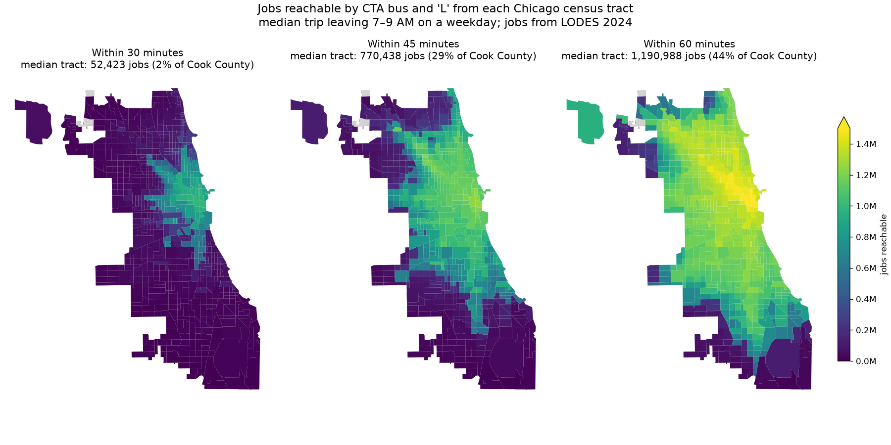
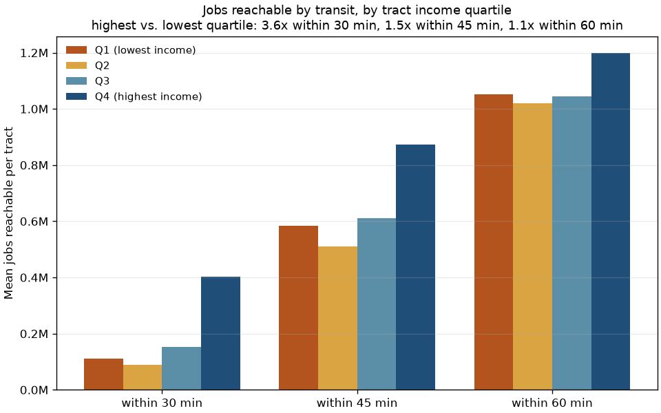
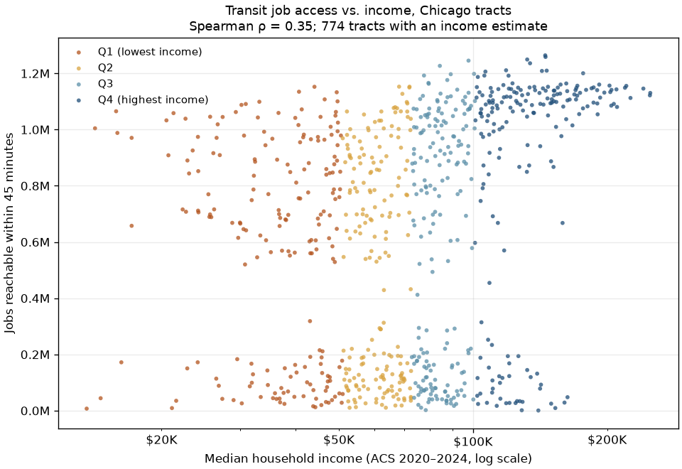

# Chicago Transit Access Analyzer

How many jobs can each Chicago neighborhood reach by bus and 'L', and how
does that vary with income? A transit router written in C++ (Connection Scan
Algorithm, with Python bindings via pybind11) computes door-to-door travel
times from every Chicago census tract to every Cook County tract, at every
minute of the weekday morning peak, from CTA's published schedules. Python
(pandas, geopandas) joins the results with job counts and census income data.

## Headline

On a weekday morning (median trip leaving 7-9 AM), **the median Chicago
tract can reach 633,000 jobs within 45 minutes by CTA**, about a quarter of
Cook County's 2.7 million. **Tracts in the highest income quartile reach 1.6
times as many jobs within 45 minutes as the lowest quartile, and 3.8 times
as many within 30.** The gap comes mostly from distance to the Loop, holds
under every transfer-time assumption tested, and grows when transfers are
slower. Details in [Access and income](#access-and-income); every setting
and data source is in [docs/decisions.md](docs/decisions.md).

**Explore it:** [yezegeye.github.io/transit-access](https://yezegeye.github.io/transit-access/)
is an interactive map: pick any tract to see travel times from it, the jobs
it can reach and how it compares by income.



## Reproduce

```sh
conda env create -f environment.yml && conda activate transit
make            # build, run all tests, download data, regenerate every result
make benchmark  # C++ vs. Python timings
```

`make` downloads about 170 MB of census and CTA data into `data/raw/` and
takes a few minutes. CTA publishes only its current schedule, so a fresh
download may not cover the analysis date; see
[docs/decisions.md](docs/decisions.md#data) for the exact feed used.

## Status

The router is complete for the accessibility analysis.

**Works now**

- GTFS loading from `stops.txt` and `stop_times.txt`: header-based column
  lookup, quoted fields, UTF-8 BOM, CRLF line endings, times past 24:00:00,
  stop coordinates.
- Service days: load only the trips running on a given date, from
  `trips.txt`, `calendar.txt` and `calendar_dates.txt` (weekday patterns,
  date ranges, added/removed exceptions such as holidays). On the CTA feed a
  weekday keeps about 1.2M of the 5.8M connections; routing over every trip
  instead overstated the stops reachable within 45 minutes at 8 AM by ~70%.
- Walking transfers: `generate_footpaths` links every pair of stops within a
  straight-line distance (400 m gives 144K footpaths on CTA, in ~20 ms, via a
  lat/lon grid index). The router allows one walk after each ride. Across 200
  random CTA stops, the median number of stops reachable within 45 minutes of
  8 AM rises from 82 without walking to 3,305 with it: a bus rider could not
  otherwise change to a crossing route, whose stops have their own stop_ids.
- Earliest-arrival routing with the
  [Connection Scan Algorithm](https://arxiv.org/abs/1703.05997), from one
  stop or from several stops with their own start times. A randomized test
  checks it against a slower fixpoint reference.
- Door-to-door travel time matrices between arbitrary points (e.g. tract
  centroids) for many departure times: walk to nearby stops, ride, walk to the
  destination. Multithreaded; 800 points x 25 departure times on CTA takes
  ~2 s on 8 cores. Returned to Python as a NumPy array.
- Python bindings, with Catch2 and pytest suites run against small hand-made
  feeds, on every push via GitHub Actions.

**Current limitations**

- Walking distances are straight lines, not along streets. The analysis
  compensates with a 1.2 detour factor folded into the walking speed, which
  is right on average but not for any particular walk (a river or rail yard
  can make the real walk much longer).
- Walks are not chained: one walk after each ride, plus the walks to the
  first stop and from the last. `transfers.txt` is ignored.
- Changing vehicles takes the same fixed time everywhere (2 minutes in the
  analysis), though real CTA transfers range from across the platform to a
  long tunnel. See the sensitivity check.
- A service day includes its own trips that run past midnight (times after
  24:00:00) but not the previous day's late-night trips.
- Stop times without an arrival/departure time (non-timepoints) are rejected
  rather than interpolated.

**Possible extensions**

- Add Pace buses and Metra trains (both publish GTFS), which matter most
  for the Far South and Northwest Sides.
- Compare a late-evening and a Sunday run with the weekday morning.
- Other destinations, such as grocery stores or clinics.
- Speed: reuse work across departure times (profile Connection Scan or
  RAPTOR) instead of routing each minute separately; see
  [Performance](#performance).

## Validation

Besides the unit tests, randomized checks compare the scan with an
order-independent reference, confirm that leaving later never arrives
earlier (also on the full CTA weekday: no violations in 40M comparisons) and
check every reconstructed journey against the timetable.

Five station-to-station trips leaving 8:00 AM on Wed 18 Nov 2026 were
compared with Google Maps (bus and subway only), using
`python analysis/check_trips.py`, which prints the router's route. Times
are ride minutes from the first boarding, with no minimum transfer time:

| Trip | Router's route | Router | Google |
|---|---|---|---|
| O'Hare to Clark/Lake | Blue | 40.5 | 39 |
| Howard to Roosevelt | Purple Express to Wilson, then Red | 35 | 39 |
| Midway to Addison | Orange to Roosevelt, then Red | 47.7 | 54 |
| Kimball to 95th/Dan Ryan | Brown to Belmont, then Red | 62.5 | 72 |
| Jefferson Park to Midway | Blue to Clark/Lake, then Orange | 57.5 | 62 |

The router's ride times match CTA's published schedule to the second (for
O'Hare to Clark/Lake, the 8:00:30 train arrives 8:41:00). The gaps on
transfer trips come from transfer time: Google took the same Orange Line
train from Midway but allowed about 9 minutes for the tunnel to the Red Line
at Roosevelt, while the router allowed a 1-minute walk. This led to the
2-minute minimum transfer time used in the analysis. Kimball to 95th is
still about 6 minutes faster than Google even with a 5-minute transfer,
probably because Google chose a different route.

## Performance

Measured on a 2020 MacBook (Intel Core i5-1038NG7, 4 cores / 8 threads),
CTA weekday: 1.2M connections, 11,138 stops, 144K footpaths, 2-minute
transfers.

**C++ against pure Python.** `python analysis/benchmark.py` runs the same
Connection Scan, ported line by line to plain Python lists, on 200 random
queries (a stop, a departure between 7 and 9 AM, every stop reached within
90 minutes), checks that both give identical answers, then times them
(`results/benchmark.csv`):

| Implementation | Queries per second | p50 per query | p99 per query |
|---|---|---|---|
| C++ (called from Python) | 816 | 1.20 ms | 1.83 ms |
| Pure Python | 32 | 31.2 ms | 43.6 ms |

The C++ router is 26 times faster at the median. Both run the same
algorithm on the same data, so the gap comes from the language: compiled
code over packed integer arrays against interpreted bytecode handling
boxed Python integers.

**The full analysis.** 793 origins x 121 departures x 1,331 destinations
(`build/bench_matrix`, which times `travel_time_matrix` alone): 53 s on one
thread, 11 s on 8 threads.

**Profiling.** macOS `sample` on the full analysis put about 85% of samples
in the connection scan, most of the rest in adding the final walk to each
destination tract and in per-query memory allocation. Counting the work in
one query (60 minutes of connections from a random stop) showed where the
scan's time goes: 75K connections examined, of which 7.9K could be boarded
and 3.2K improved an arrival; 45K footpath updates; and 39K lookups to add
the final walk to destinations. About 160K small memory operations at
roughly 3 ns each. Two fixes were tried and measured with interleaved runs,
best of five:

| Version | 40 origins, 1 thread |
|---|---|
| Original | 2.08 s |
| Footpaths in one flat array instead of one vector per stop | 2.08 s |
| Flat array, and per-query arrays reused across queries | 2.08 s |

Neither helped, so both were reverted to keep the simpler code. (A first
attempt at reusing arrays was about 8% *slower*: with the arrays behind a
reference, writes to the `char` trip flags may alias anything, so the
compiler reloaded every array's address after each write. Taking plain
pointers fixed that.) The scan is bound by the number of connections it
must look at, not by memory layout or allocation. The next real speedup
would be algorithmic: reusing work across the 121 departure times
(profile Connection Scan or rRAPTOR) instead of routing each one from
scratch.

## Analysis data

`python analysis/prep_data.py` downloads the inputs (cached in `data/raw/`)
and writes one row per Cook County census tract (2020 boundaries) to
`data/processed/cook_tracts.gpkg` (with shapes) and `cook_tracts.csv`.

| Field | Source |
|---|---|
| `lat`, `lon`, `pop_2020` | 2020 Census population-weighted tract centroids: the router starts and ends trips where people live, not at the geometric middle of a tract |
| `geometry`, `land_m2` | Census cartographic boundary tracts (clipped to the shoreline, for maps) |
| `in_chicago` | Centroid inside the City of Chicago boundary (Census places) |
| `jobs`, `jobs_low_wage`, `jobs_mid_wage`, `jobs_high_wage` | LEHD LODES 8 workplace area characteristics, 2024, all jobs (JT00), summed from blocks to tracts; low/mid/high = up to $1,250, $1,251-$3,333, over $3,333 a month |
| `median_income`, `median_income_moe` | ACS 2020-2024 5-year, table B19013 (top-coded at 250,001) |
| `population`, `households`, `households_no_vehicle`, `share_no_vehicle` | ACS 2020-2024 5-year, tables B01003 and B08201 |

The result: 1,331 Cook County tracts (793 in Chicago), 2.70M jobs (1.47M in
Chicago), 5.18M people (2.71M in Chicago). The lake-only tract 17031990000 has
no shape and is left out. 19 Chicago tracts have no income estimate: 3 have no
residents (O'Hare, Midway, one industrial tract) and the Census suppressed
the other 16 for small samples. The ACS summary files are used instead of the
Census API, which now requires a key.

## Job access

`python analysis/job_access.py` routes from every Chicago tract's population
centroid to every Cook County tract's, leaving every minute from 7:00 to
9:00 AM on Wednesday 18 Nov 2026 (CTA weekday service). Walks are measured
as straight lines up to 800 m at each end and 400 m between stops, and
walked at 5 km/h along streets assumed 1.2 times the straight-line distance
(1.157 m/s over the straight line). Changing vehicles takes 2 minutes on top
of any walk. For each pair it takes the median travel time over the 121
departures, then counts the jobs in every tract reachable within 30, 45 and
60 minutes (793 x 1,331 tracts x 121 departures: about 14 s on 8 cores). Output: `data/processed/job_access.csv` and the median
travel-time matrix `travel_times.npz`.
`python analysis/plot_job_access.py` draws `results/job_access_map.png`.

| Within | Median Chicago tract | 10th percentile | 90th percentile |
|---|---|---|---|
| 30 min | 46,225 jobs (2% of Cook County) | 10,622 | 667,716 |
| 45 min | 633,132 (23%) | 41,013 | 1,076,056 |
| 60 min | 1,131,815 (42%) | 295,355 | 1,321,173 |

The jump from 30 to 45 minutes is the Loop: its three largest tracts alone
hold about 450,000 jobs, a sixth of Cook County's, and the median trip to the
central Loop tract takes 40 minutes.
The model covers CTA only, so places served mainly by Metra or Pace (two
Far Northwest Side tracts have no CTA stop within 800 m) score low, and
suburban job centers are under-counted as destinations.

## Access and income

`python analysis/equity.py` splits the 774 Chicago tracts with an ACS income
estimate into four equal-sized quartiles of median household income and
compares their transit job access. It writes `results/access.csv` (per
tract), `results/equity.csv` (per quartile) and the two figures below.

| Income quartile | Median income | Mean jobs within 30 min | 45 min | 60 min | Households without a car |
|---|---|---|---|---|---|
| Q1 (lowest) | $13.6K-51.0K | 96,260 | 500,663 | 976,633 | 36% |
| Q2 | $51.0K-72.6K | 73,995 | 438,171 | 925,419 | 25% |
| Q3 | $72.9K-101.0K | 126,146 | 519,987 | 967,479 | 22% |
| Q4 (highest) | $101.1K-250K+ | 363,138 | 816,191 | 1,124,276 | 25% |
| **Q4 / Q1** | | **3.8x** | **1.6x** | **1.2x** | |

Spearman rank correlation between income and jobs reachable: 0.37 (30 min),
0.33 (45 min), 0.40 (60 min).

What this shows:

- Tracts in the highest income quartile reach 1.6 times as many jobs within
  45 minutes as the lowest, and 3.8 times as many within 30. The gap narrows
  with longer trips: within an hour, most of the city reaches the Loop.
- Access does not fall steadily with income. The lowest quartile does better
  than the second: more of its tracts sit close to the Loop, on the Near
  West and Near South Sides (22% within 8 km of the Loop, against 17% of the
  second quartile). The highest quartile is the closest by far (median
  7.3 km, against 11-12 km for the others), mostly on the North Side.
- At 45 minutes tracts split into two groups, those that reach the Loop
  (473 tracts over 500K jobs) and those that do not (308 under 300K, with
  only 12 in between): for most tracts, the time to downtown decides the
  score.

What it does not show: why the gap exists, whether residents actually work
at the reachable jobs (LODES counts jobs where they are, regardless of skill
or wage match), or access by car, Metra or Pace. The lowest quartile also
has the most car-free households (36%), so it depends on transit most.




### Sensitivity to the transfer time

How long it takes to change vehicles is the least certain setting: a
trip-planner check found CTA transfers ranging from across the platform
(Belmont, Wilson) to a long tunnel (Roosevelt, about 9 minutes in Google
Maps). `python analysis/sensitivity.py` reruns everything at 0, 2 and 5
minutes (`results/sensitivity.csv`):

| Transfer time | Median tract, jobs within 45 min | Top / bottom quartile, 30 min | 45 min | 60 min | Spearman, 45 min |
|---|---|---|---|---|---|
| 0 min | 770,438 | 3.60x | 1.49x | 1.14x | 0.35 |
| **2 min (headline)** | **633,132** | **3.77x** | **1.63x** | **1.15x** | **0.33** |
| 5 min | 534,095 | 4.04x | 1.79x | 1.19x | 0.33 |

Slower transfers lower everyone's access, but the gap between the highest
and lowest income quartiles grows: lower-income tracts rely more on trips
with transfers. The conclusion holds at every setting.

## Layout

- `cpp/` — routing core (static library `router`: `router.*` for GTFS loading
  and routing, `geo.*` for distances and the spatial grid) and pybind11
  bindings (`transit_router`)
- `cpp/tests/` — Catch2 unit tests
- `cpp/bench/` — `bench_matrix`, a timing harness for the full analysis workload
- `python/tests/` — pytest tests against the compiled module
- `analysis/` — Python analysis scripts (`prep_data.py`, `job_access.py`,
  `plot_job_access.py`, `equity.py`, `sensitivity.py`, `export_web.py`,
  `check_trips.py`, `benchmark.py`) and their tests
- `web/` — the interactive website (`index.html`, plus `data.json` written by
  `analysis/export_web.py`), deployed to GitHub Pages on every push to `main`
- `results/` — figures and result tables (`access.csv`, `equity.csv`,
  `sensitivity.csv`, `benchmark.csv`)
- `data/fixtures/` — small hand-made GTFS feeds used by the tests
- `data/raw/` — downloaded GTFS feeds and census files (git-ignored)
- `data/processed/` — outputs of `analysis/prep_data.py` (git-ignored, rebuilt by the script)

## Usage

```python
import transit_router as tr

tt = tr.Timetable.from_gtfs_dir("data/fixtures/tiny")
tr.earliest_arrival(tt, "A", tr.parse_gtfs_time("08:00:00"))
# {'A': 28800, 'B': 29400, 'C': 30000, 'D': 30300}  (seconds after midnight)

# Walking transfers between stops within 1200 m (the tiny feed's stops are
# about 1.1 km apart): ride to B, then walk to D instead of waiting for T2.
tt.generate_footpaths(max_distance_m=1200, walk_speed_mps=1.3)
tr.earliest_arrival(tt, "A", tr.parse_gtfs_time("08:00:00"))["D"]
# 30256  (08:24:16, vs 08:25:00 by bus)

# Only the trips running on one service day (a datetime.date or "YYYYMMDD"):
import datetime
saturday = tr.Timetable.from_gtfs_dir("data/fixtures/tiny", date=datetime.date(2026, 10, 17))
tr.earliest_arrival(saturday, "A", tr.parse_gtfs_time("08:00:00"))
# {'A': 28800, 'D': 31200}

# Arrival time at every stop as a NumPy array (indexed like tt.stop_ids),
# leaving out stops not reached within max_seconds; the route to one stop:
tr.arrival_times(tt, "A", tr.parse_gtfs_time("08:00:00"), max_seconds=3600)
tr.journey(tt, "A", tr.parse_gtfs_time("08:00:00"), "D")

# Door-to-door travel times between (lat, lon) points for several departures,
# as an array of shape (origins, departures, destinations) in seconds:
import numpy as np
deps = [tr.parse_gtfs_time(f"08:0{m}:00") for m in range(5)]
m = tr.travel_time_matrix(tt, [(0.0, 0.0)], [(0.01, 0.01)], deps, max_access_m=100)
np.median(m, axis=1)  # [[2220.]]: median over departures; np.inf if unreachable
```

## Setup

Requires CMake ≥ 3.18 and a C++17 compiler.

```sh
conda env create -f environment.yml
conda activate transit
```

## Build

```sh
cmake -S . -B build \
  -DPython_EXECUTABLE="$(which python)" \
  -Dpybind11_DIR="$(python -m pybind11 --cmakedir)"
cmake --build build -j
```

The Python module is written to `build/`; the root `conftest.py` puts that
directory on `sys.path` for tests, and the analysis scripts look there too.
`make build` runs the same two commands.

## Test

```sh
ctest --test-dir build --output-on-failure   # C++
python -m pytest                             # Python (run inside the transit env)
```

`make test` runs both.
